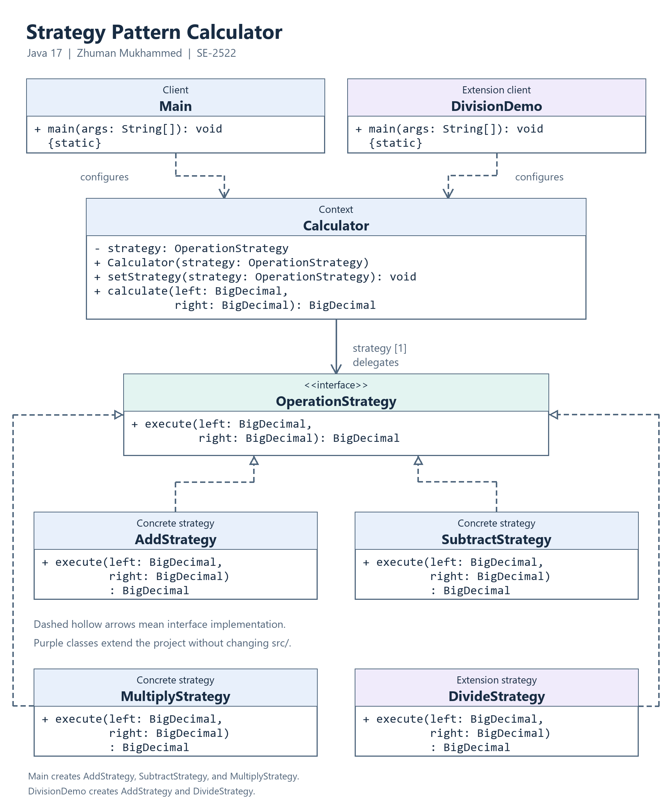

# Assignment 5 - Strategy Pattern

**Student:** Zhuman Mukhammed  
**Group:** SE-2522  
**Course:** Software Design Patterns, 2026-2027  
**Topic:** Option B - Calculator  
**Prepared:** 23 October 2026

## 1. Introduction

The application is a console calculator whose algorithm family consists of addition, subtraction, and multiplication. Each algorithm accepts two `BigDecimal` operands and returns a `BigDecimal`. The client chooses an operation; the `Calculator` context delegates calculation to an object implementing `OperationStrategy`.

One context is reused while its strategy changes at runtime. With operands 12 and 4, the demo prints 16, 8, and 48 after selecting addition, subtraction, and multiplication respectively. A separate division example extends the same interface without editing the original classes.

`BigDecimal` is constructed from input strings to preserve decimal values. Core operations are exact; the optional division strategy uses `MathContext.DECIMAL64`, so repeating results are rounded to 16 significant digits using HALF_EVEN. [1]

## 2. UML class diagram



[Open the full-resolution PNG](docs/strategy.png) | [Editable Mermaid source](docs/strategy.mmd)

`Main` is the original client, `Calculator` is the context, and `OperationStrategy` is the common abstraction. Dashed realization arrows show interface implementations. `Calculator` holds one strategy reference; it does not own the strategies' lifetimes. `DivideStrategy` and `DivisionDemo` belong to the separate extension example. The editable diagram is also saved in `docs/strategy.mmd`.

## 3. Clean Code

### 3.1 Replace algorithm conditionals with polymorphism

Actual excerpt from `Calculator.calculate`:

```java
return strategy.execute(left, right);
```

The context makes one interface call instead of testing an operation name or concrete class. Dynamic dispatch invokes the selected implementation. The client uses a map to resolve commands; its input-validation branches do not implement arithmetic or dispatch by strategy type.

### 3.2 Use intention-revealing names

Actual excerpt from `Main.createStrategies`:

```java
strategies.put("subtract", new SubtractStrategy());
```

The command and class name both identify the operation. Operand names `left` and `right` preserve meaning for subtraction and division, where order matters. This avoids ambiguous names such as `Mode2` or `doWork`.

### 3.3 Keep each class responsible for one concern

Actual method from `MultiplyStrategy`:

```java
public BigDecimal execute(BigDecimal left, BigDecimal right) {
    return left.multiply(right);
}
```

This class only implements multiplication. Console prompts and parsing belong to `Main`; holding and replacing the active strategy belong to `Calculator`. A formatting change does not require editing arithmetic classes.

### 3.4 Depend on the abstraction

Actual excerpts from `Calculator`:

```java
private OperationStrategy strategy;

public void setStrategy(OperationStrategy strategy) {
    this.strategy = Objects.requireNonNull(strategy, "Strategy must not be null.");
}
```

The context accepts the interface and imports no concrete strategy. It can receive an implementation written later. Rejecting null also preserves a valid active strategy; a failed replacement leaves the previous reference intact. The delegation test injects an unfamiliar implementation and verifies that operands and result pass through unchanged.

### 3.5 Extend behavior without changing stable classes

Actual excerpt from the new `DivisionDemo` client:

```java
calculator.setStrategy(new DivideStrategy());
System.out.println("After switching to division: " + calculator.calculate(left, right));
```

`DivideStrategy` implements the existing interface. This extension adds two files under `examples/` and changes no original file under `src/`. The context, three original strategies, and original client remain unchanged. Adding division to the original menu would require one client registration entry, but still no change to the context. This is a concrete application of the Open/Closed Principle rather than a claim that all future changes require zero configuration.

## 4. Strategy vs. State

This problem needs Strategy because the user explicitly selects an interchangeable calculation algorithm. Choosing multiplication is not a transition in the calculator's lifecycle. The strategies do not know one another, enforce transition rules, or replace themselves. State would suit behavior controlled by lifecycle conditions, such as a document moving from draft to review to publication. Both patterns may use composition and delegation; their purpose and the meaning of changing the delegated object differ. [2][3]

## 5. Conclusion

The design keeps arithmetic variation outside the context and allows runtime replacement through one interface. The division example demonstrates the resulting flexibility. The cost is additional small classes and client configuration; for only three arithmetic expressions, a simple function would be shorter, but the class-based design makes the pattern and extension boundary explicit.

Verification on JDK 17 passed 23 Java checks covering arithmetic, runtime switching, null rejection, custom delegation, and division behavior. A separate CLI suite checks menu interaction, recovery from invalid input, end-of-input, and command-line arguments. Actual results are recorded in `VERIFICATION.txt`.

## 6. GitHub repository

**Pending publication.** The project folder contains a local Git repository with incremental implementation, extension, and documentation commits. Replace this paragraph with the verified GitHub repository URL after publication. The local folder is not a substitute for the required GitHub link.

### References and preparation disclosure

1. Oracle. [BigDecimal, Java SE 17 API](https://docs.oracle.com/en/java/javase/17/docs/api/java.base/java/math/BigDecimal.html), including the linked MathContext documentation. Consulted 23 October 2026.
2. Refactoring.Guru. [Strategy](https://refactoring.guru/design-patterns/strategy). Consulted 23 October 2026 for the pattern's roles and intent.
3. Refactoring.Guru. [State](https://refactoring.guru/design-patterns/state). Consulted 23 October 2026 for comparison with Strategy.
4. Assignment 5 - Strategy Pattern, AITU, 2026-2027, supplied assignment PDF.

OpenAI Codex assisted with implementation, report drafting, and verification in this session on 23 October 2026. This report does not claim unaided authorship. Student review and the personal defense remain to be completed.
